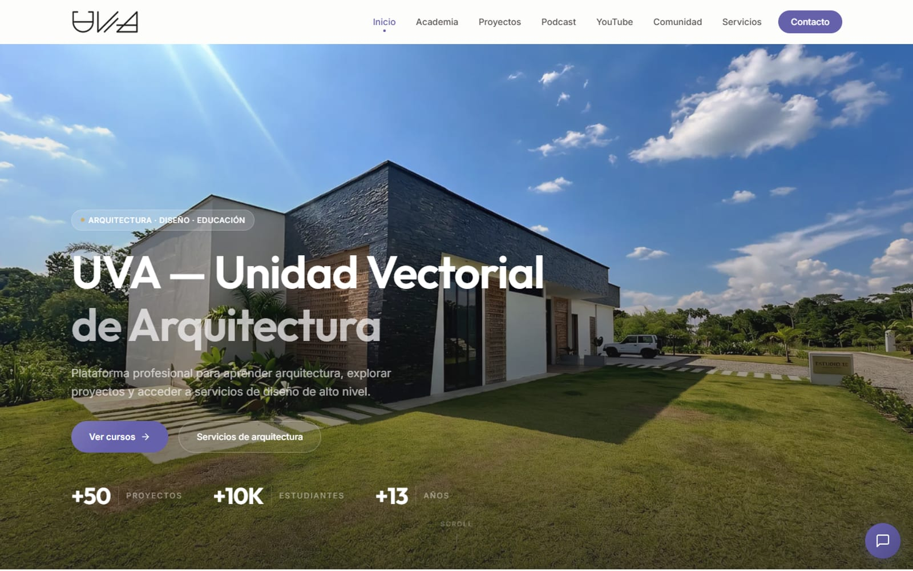
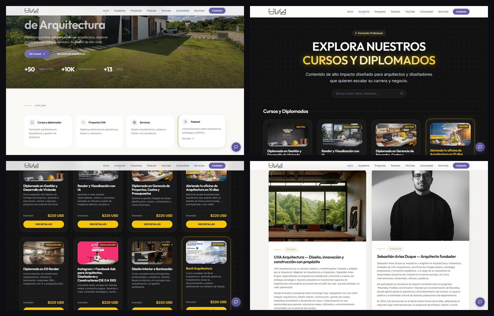
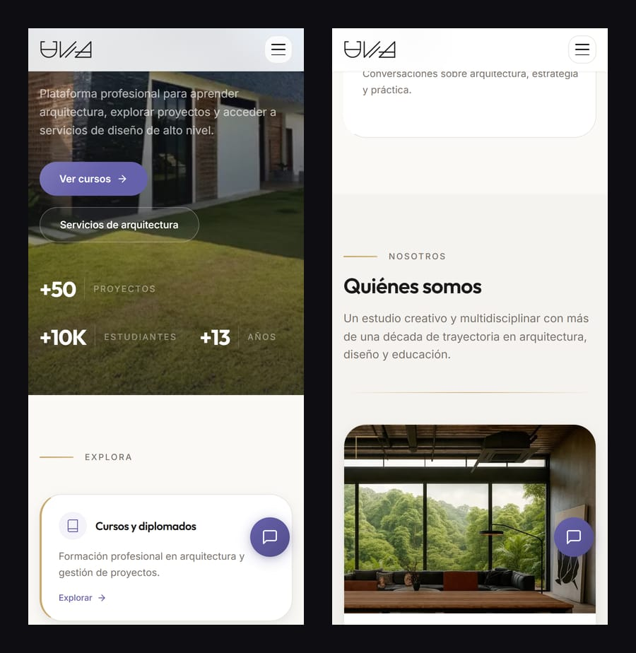

<div align="center">



# UVA Web 2.0

**El sitio de UVA — Unidad Vectorial de Arquitectura: academia, estudio y comunidad en una sola web que vende cursos, muestra proyectos y atiende con un asistente de IA a cualquier hora.**

<br/>

[](https://www.uvarq.com/)
[](https://github.com/Kin9Zeus/UVAWebDL/actions/workflows/ci.yml)


[El sitio](#el-sitio) · [Destacados](#destacados) · [Capturas](#capturas) · [Arquitectura](#arquitectura) · [Arrancar](#arrancar)

</div>

---

## El sitio

UVA es la marca del arquitecto **Sebastián Arias Duque**: un estudio de arquitectura, una academia con diplomados y libros, un podcast y una comunidad. Antes cada cosa vivía en un lugar distinto; esta web las reúne con un solo objetivo comercial: que un arquitecto, diseñador o estudiante encuentre el curso o servicio que necesita y llegue a comprarlo o a hablar con el equipo en pocos clics.

| Sección | Qué hace |
|---|---|
| **Inicio** | Presentación, cifras de la marca y accesos a academia, proyectos, servicios y podcast. |
| **Cursos** | Catálogo y **14 landings de venta** dedicadas — Render con IA, Revit, SketchUp, D5 Render, Claude IA, gerencia de proyectos, vivienda, odontología, redes con IA, libros y más — cada una con temario, precio y llamado a WhatsApp. |
| **Proyectos · Servicios** | Portafolio del estudio y servicios de arquitectura, interiorismo y construcción. |
| **Podcast · YouTube** | Últimos episodios y videos del canal, leídos de la API de YouTube con caché de 60 s. |
| **Comunidad · Contacto** | Membresía y formulario que guarda cada lead en MongoDB. |

## Destacados

| | |
|---|---|
| 🤖 **Asistente de ventas con IA** | Un chat entrenado con el catálogo real responde dudas y lleva al curso correcto. Reglas estrictas de alcance (solo UVA y arquitectura), prohibido inventar precios o enlaces, respuestas cortas que siempre cierran con una acción. Corre en el servidor con **Gemini**, con límite de **20 mensajes por minuto por IP** y respuestas acotadas a 350 tokens. |
| 🎯 **Medición sin perder datos** | Google Tag Manager, GA4 y Meta Pixel en el cliente, más **Meta Conversions API** desde el servidor para leads y compras. Cada evento lleva un `eventID` compartido para deduplicar, y los datos personales se envían con **hash SHA-256**. **Consent Mode v2** arranca en *denegado* hasta que la persona acepta en el banner de cookies. |
| 🧾 **Leads validados** | El formulario valida con **Zod** en el servidor antes de escribir en MongoDB vía Mongoose. |
| 🔎 **SEO estructurado** | JSON-LD de `EducationalOrganization`, `Person`, `WebSite` con `SearchAction` e `ItemList` del catálogo; `sitemap.xml`, `robots.txt` y `llms.txt` para motores de IA. |
| 📚 **Catálogo como datos** | Cursos y proyectos viven en `src/lib/data/`, de donde salen las páginas, el JSON-LD y el conocimiento del asistente. |

## Capturas

<div align="center">
  
  <br/><sub><b>Escritorio</b> — accesos de la portada, catálogo de cursos y diplomados, tarjetas de precio y el estudio.</sub>
  <br/><br/>
  
  <br/><sub><b>Móvil</b></sub>
</div>

## Arquitectura

```
src/
├── app/
│   ├── page.tsx                inicio
│   ├── cursos/                 catálogo + 14 landings de venta
│   ├── proyectos · servicios · podcast · youtube · comunidad · contacto
│   ├── api/chat/route.ts       asistente (Gemini, límite por IP)
│   ├── api/leads/route.ts      leads (Zod → MongoDB)
│   └── sitemap.ts · robots.ts
├── components/
│   ├── landing-page-*-client.tsx   una landing por producto
│   ├── analytics/                  GTM, GA4, Pixel, banner de consentimiento
│   └── chat-widget.tsx · json-ld.tsx · nav · footer
├── lib/
│   ├── data/                   courses.ts · projects.ts
│   ├── analytics/              gtm · meta-pixel · meta-capi
│   ├── db.ts · seo.ts · youtube.ts
└── models/Lead.ts
```

La guía completa de medición está en [`docs/TRACKING_SETUP.md`](docs/TRACKING_SETUP.md) y el historial de cambios de contenido en [`CHANGELOG.md`](CHANGELOG.md).

## Arrancar

```bash
npm install
npm run dev          # http://localhost:3000
```

Crea `.env.local` con las variables que uses:

| Variable | Para qué |
|---|---|
| `MONGODB_URI` | Base de datos de leads |
| `GEMINI_API_KEY` | Asistente de IA (solo servidor) |
| `NEXT_PUBLIC_BASE_URL` | Enlaces absolutos del asistente |
| `NEXT_PUBLIC_GTM_ID` · `NEXT_PUBLIC_GA_ID` · `NEXT_PUBLIC_FACEBOOK_PIXEL_ID` · `FACEBOOK_ACCESS_TOKEN` | Medición (ver `docs/TRACKING_SETUP.md`) |
| `NEXT_PUBLIC_WHATSAPP_URL` · `NEXT_PUBLIC_INSTAGRAM_URL` · `NEXT_PUBLIC_YOUTUBE_URL` · `NEXT_PUBLIC_SPOTIFY_URL` | Enlaces de contacto y redes |
| `YOUTUBE_API_KEY` | Últimos videos del canal |

Producción: `npm run build && npm start`.

## Licencia

© 2026 Devleck (Aleck Martinez). **Todos los derechos reservados.** El código se publica como caso de estudio de portafolio: puedes leerlo y ejecutarlo en local para evaluarlo, pero no copiarlo, redistribuirlo ni usarlo en otro producto sin permiso escrito. Las marcas, logotipos, fotografías y textos pertenecen a sus respectivos dueños. Ver [LICENSE](LICENSE) · Permisos: contact@devleck.com

---

<div align="center">
<sub>Diseñado y desarrollado por <a href="https://www.devleck.com">Devleck</a> — Aleck Martinez.</sub>
</div>
